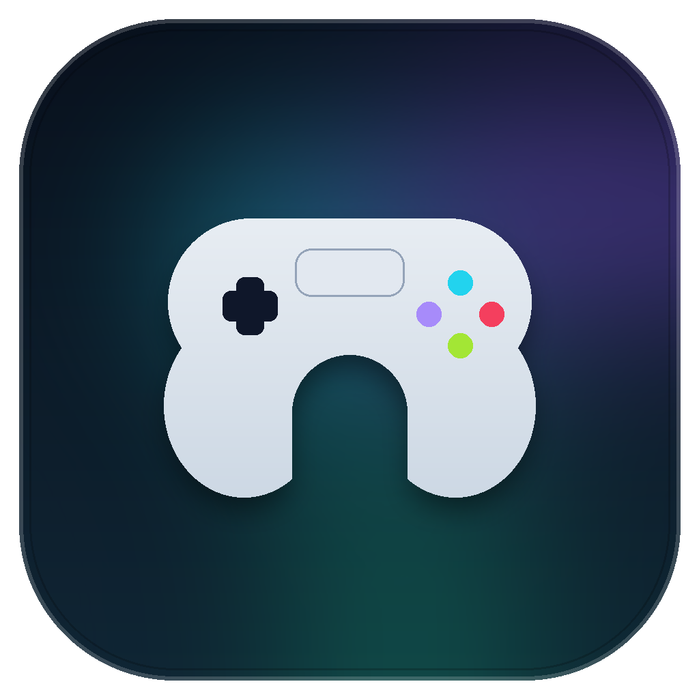
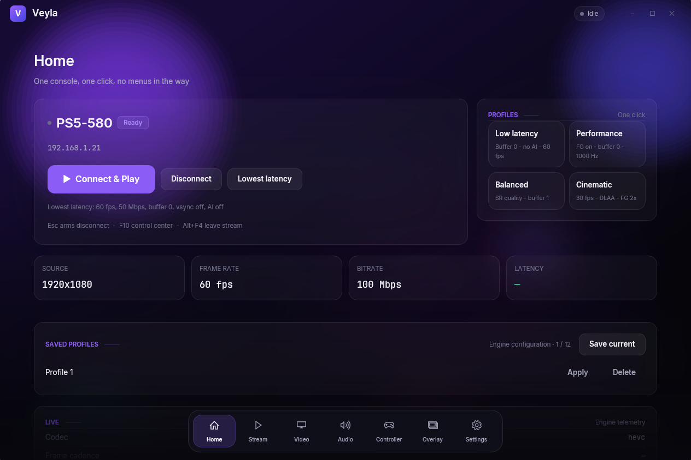

<p align="center">
  
</p>

<h1 align="center">Veyla</h1>

<p align="center">
  <b>Play your PS5 on your PC. Without feeling the distance.</b><br>
  A low-latency Remote Play client for Windows, with GPU upscaling, frame
  generation and one-click updates.
</p>

<p align="center">
  
  
  
  <a href="https://ko-fi.com/bulinatu"></a>
</p>



---

> **3.0.0 beta 1 is out:** FSR upscaling, a pure Direct3D 12 Watch surface and
> native in-process DLSS-G. [Download the beta](https://github.com/bulinatu/Veyla/releases/tag/v3.0.0-beta1).
> The previous stable build remains [2.7.2](https://github.com/bulinatu/Veyla/releases/tag/v2.7.2).

---

## What is Veyla?

Veyla connects your PC to a PlayStation 5 on the same network and streams the
game to a normal window - no browser, no console hacks, no account juggling.
The point is latency: frames are shown the moment they are decoded, and the
optional AI stages run on the GPU so they do not get in the way.

You pair once, pick a preset, and press **Connect & Play**.

## What you get

**Picture**
- 1080p60 by default, with a frame buffer of 0 - the lowest-latency path.
- DLSS Super Resolution on RTX, or AMD FSR 4.1.2 / 3.1.6 on Radeon, to clean up and upscale the stream.
- Native DLSS Frame Generation on DX12: 2x on RTX 40, the driver's multi-frame
  count on RTX 50, plus a neural renderer for motion smoothing.
- Works with 30 fps games too: they stay 60 on the wire and frame generation
  keeps the motion smooth.

**Control**
- DualSense over USB or Bluetooth: sticks, triggers, touchpad, motion,
  lightbar, player LEDs.
- Haptics and adaptive triggers where the game uses them.
- Keyboard and mouse passthrough, per-game profiles.

**Quality of life**
- One window with Home, Stream, Video, Audio, Controller and Overlay pages.
- Settings save instantly - no Apply button, no restart.
- Built-in update check: new versions install themselves from GitHub Releases.
- Live diagnostics: latency, frame age, present lag, drops, codec, bitrate.

## Install

1. Download **`Veyla-2.6.0-standalone.zip`** from
   [Releases](../../releases).
2. Extract it anywhere - no installer, no background service.
3. Run `veyla.exe`. If Windows asks about network access, allow it for
   `veyla-engine.exe`.
4. On the PS5, enable **Settings > System > Remote Play > Enable Remote Play**.
5. In Veyla, press **Connect & Play** and enter the code shown on the console.

### First-time setup (2.7.0 and later)

With no console paired, a **Set up your PS5** chip appears under the logo. It
opens **Settings > Pairing**:

1. Press **Discover** - your console appears with its name and address.
2. Press **Use**, then enter the 8-digit PIN shown by
   **PS5 > Settings > System > Remote Play > Link Device** and press **Pair**.
3. Optional, for play outside the LAN: **Open login** links a PSN account. Sign
   in through the browser, paste the redirect URL back and press **Link**.

The chip disappears once a console is paired.

Before 2.7.0 there was no setup screen at all: a new user could not discover or
pair from the app and had to run `veyla-classic.exe`, open *Streaming > Console*
and pair there. That detour is no longer needed.


Your settings live in `%APPDATA%\BetterRemotePlayNext` (kept from the original
project name, so existing pairings keep working).

## Requirements

- Windows 10 or 11, 64-bit.
- A PS5 on the same LAN as the PC (wired is best).
- Optional: an NVIDIA RTX GPU for DLSS Super Resolution and Frame Generation.
  Without one, streaming and upscaling still work.

## Updates

Veyla checks [Releases](../../releases) at launch. When a newer version exists,
the home screen offers the download and the installer applies it silently, then
reopens the app. You can also update from **Advanced > Updates**.

## Build from source

```powershell
cmake -S . -B build -DCMAKE_BUILD_TYPE=Release
cmake --build build --config Release --parallel
powershell -File tools\build_ui.ps1
powershell -File tools\package_release.ps1
```

You need Visual Studio 2022 (C++20), CMake 3.25+, Rust (stable) and Python 3
for the icon generator. `vendor/chiaki-ng` is a submodule - clone with
`--recursive`.

## Known limits

- **PS5 only for now.** PS4 is not supported yet: the video path is HEVC, and
  PS4 Remote Play is H.264. Discovery, pairing and input are already in place.
- Remote Play is capped at 1080p by the console; 1440p and 4K in Veyla are a
  client-side upscale, not a stream resolution.
- HDR is not implemented.

## Roadmap

Not promises, just the direction - roughly in order:

- **PS4 video** - the H.264 path. Discovery, pairing and input already work; only
  the decoder choice is missing.
- **Controller overlay, built for streaming** - press a button, see it on
  screen: sticks, triggers and buttons live, with position, scale and opacity
  settings and a separate always-on-top window you can add in OBS. Off by
  default, opened from the in-game control centre.
- **Themes** - beyond the dark aurora: a light theme and a custom accent colour.
- **Adaptive bitrate** - raise and lower from packet loss instead of a fixed
  number you have to tune yourself.
- **Haptics tuning** - rumble intensity and adaptive-trigger strength sliders.
- **Latency graph** - frame-time chart next to the numbers, plus one-click
  export of a diagnostics report.
- **Screenshots and clips** - a hotkey that saves a screenshot, and later the
  last few seconds of the stream.
- **Localisation** - more interface languages.

Ideas and bug reports are welcome in [Issues](../../issues).

## Support

Veyla is free, and it stays free. If it saves you a walk to the living room,
you can buy me a coffee - it goes into test hardware, the Windows build machine
and the hours spent chasing the last few milliseconds.

<p align="center">
  <a href="https://ko-fi.com/bulinatu"></a>
</p>

## Credits

- [chiaki-ng](https://github.com/streetpea/chiaki-ng) - the Remote Play protocol
  implementation this project builds on.
- [GPUI](https://gpui.rs) by Zed Industries - the shell UI (Apache-2.0).
- Inter and JetBrains Mono - SIL Open Font License.

**Veyla is not affiliated with Sony Interactive Entertainment.** "PlayStation"
and "PS5" are trademarks of Sony Interactive Entertainment Inc. This project
ships no Sony code, no console modifications and no game content.

BetterRemotePlay is the original name of this project and remains a trademark
of its author; it survives only in compatibility paths such as
`%APPDATA%\BetterRemotePlayNext`.
