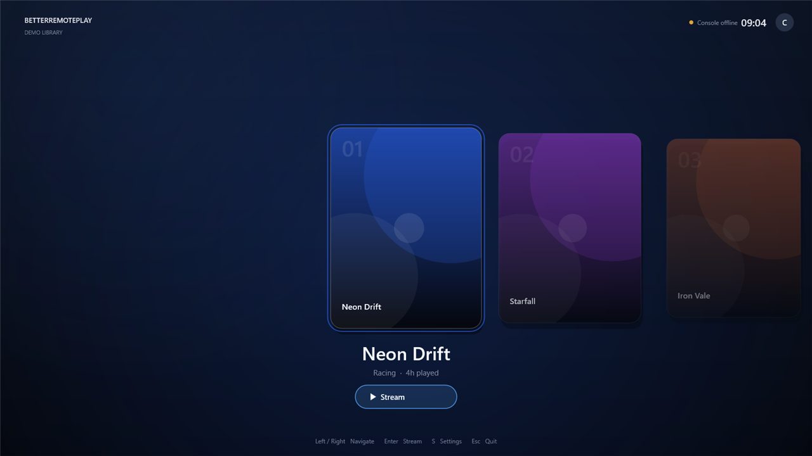
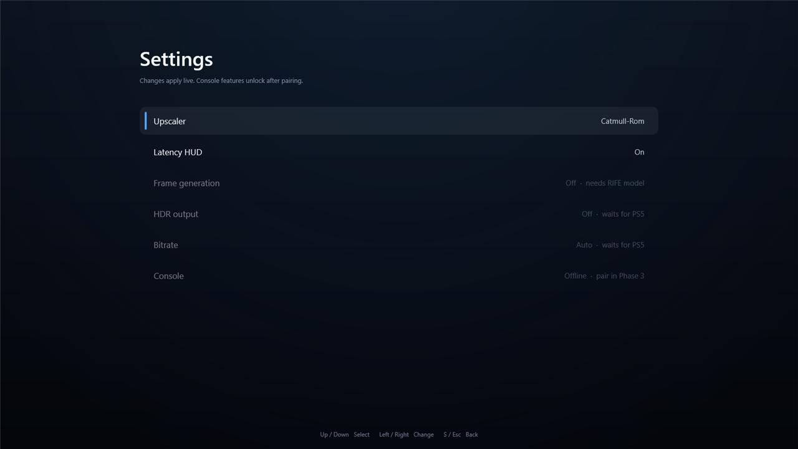
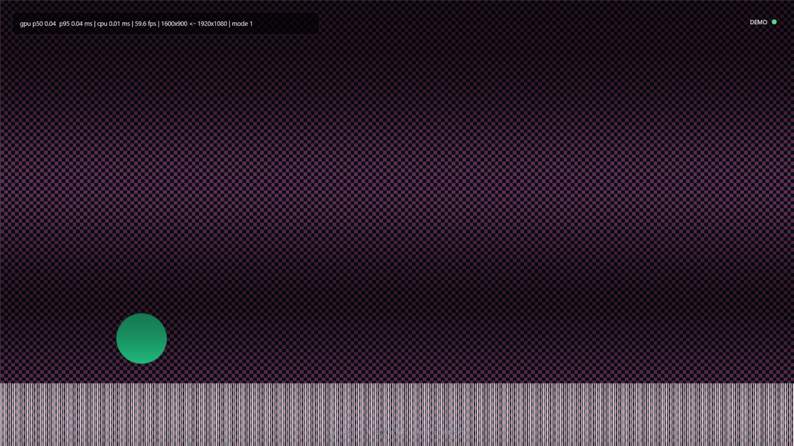

# 08 — The application shell

Status: **v0.2 — navigable app, no console attached.** Everything on screen is real except the game library and the stream source, which are demo data standing in for PSN metadata and the PS5 decoder.

---

## What it is

One native window, one D3D11 device, no browser:

- **Home** — PS5-inspired horizontal rail, animated selection, dynamic accent glow, live clock and console status.
- **Settings** — working upscaler and HUD toggles; console-dependent rows are visible but clearly marked as waiting.
- **Stream** — the measured post-process pipeline running full-window, with a live latency HUD.







The stream screen is the same code path that will carry the PS5 feed: `source frame → color/upscale stage → present`. Today the source is a synthetic frame generator; swapping in an HEVC decoder output changes one pointer, not the pipeline.

---

## Keys

| Screen | Keys |
|---|---|
| Home | `Left` / `Right` (or `A` / `D`) move selection · `Enter` stream · `S` or `Tab` settings · `Esc` quit |
| Settings | `Up` / `Down` select row · `Left` / `Right` change value · `S` / `Esc` back |
| Stream | `Esc` back · `H` toggle HUD · `1` / `2` / `3` upscaler |
| Any | `F12` capture the current frame to `app-<screen>.bmp` |

---

## Code map

```
src/main_app.cpp          message loop, 60 Hz pacing
src/app/app.{h,cpp}       screens, layout, input, animation, demo library
src/ui/ui_renderer.*      Direct2D + DirectWrite wrapper (rects, rounded clips,
                          gradients, text cache)
src/ui/theme.h            palette; 0xRRGGBB + alpha helpers
src/media/pipeline.*      D3D11 device + flip-model swapchain + stream surface
src/platform/win32_window.*  window + message pump, per-monitor DPI
tools/brp-bench/          headless-ish benchmark of the media path
tools/d2d_probe/          isolates D2D/D3D11 interop problems from app code
tools/imgstat.py          detail/clipping metrics on captured frames
```

`brp` = the app, `brp-bench` = the benchmark, `brp_media` / `brp_ui` = static libs.

---

## Design rules that are now enforced by the code

1. **No browser in the video path.** The shell is Direct2D drawing onto the same swapchain. Nothing composites over the stream except the HUD, in the same pass.
2. **One device.** The decoder, the post-process chain, the presenter, and the UI share one `ID3D11Device`. Zero cross-device copies.
3. **The UI can never own a frame.** `App` calls `presenter.Render()` / `Clear()` and then draws. It does not allocate or queue frames.
4. **Logging over guessing.** The pipeline reports per-frame GPU p50/p95; the HUD shows it live.

---

## Gotchas found while building this (worth keeping)

- **Direct2D refuses a target bitmap unless the underlying texture has `D3D11_BIND_SHADER_RESOURCE`.** A default swapchain backbuffer has only `RENDER_TARGET`. Fix: create the swapchain with `BufferUsage = RENDER_TARGET_OUTPUT | SHADER_INPUT`. Without it, every `CreateBitmapFromDxgiSurface` call returns `E_INVALIDARG` — with no useful diagnostics. Reproduce/verify with `d2d_probe`.
- **D2D holds a reference to the backbuffer.** `ResizeBuffers` then fails with `DXGI_ERROR_INVALID_CALL`. Order must be: `ui.ReleaseTarget()` → `swapchain.ResizeBuffers()` → rebind target.
- **`D2D1CreateDevice` requires the D3D11 device to be created with `D3D11_CREATE_DEVICE_BGRA_SUPPORT`.**
- **Vsync is not a frame limiter on virtual/remote displays.** The UI loop paces itself at 60 Hz explicitly; without that it spun at ~2300 fps.

---

## What is demo data, and what that means

| Thing | Now | When wired |
|---|---|---|
| Game library | 8 invented titles with procedural art | PSN library via OAuth (Phase 6) |
| Status dot | always "Console offline" | discovery result + session state |
| Stream source | synthetic 1080p generator | HEVC decode output (Phase 2) |
| HUD bitrate | not shown | requested vs actual from the session |
| Frame generation row | disabled, labeled "needs RIFE model" | TensorRT RIFE stage (Phase 5) |
| HDR row | disabled, labeled "waits for PS5" | 10-bit swapchain + PQ path (Phase 2) |

Nothing in the UI claims a capability the pipeline doesn't have. That is deliberate: a settings screen that lies is worse than a shorter one.

---

## Next

1. Compile chiaki-ng's core into `brp-session`, pair the console, and replace the synthetic source with decoded frames.
2. Swap the shader upscaler for CAS/NIS (no crushed blacks — see [07-bench-log.md](07-bench-log.md)).
3. Fullscreen/exclusive presentation mode, so the output resolution setting is exact instead of window-sized.
4. Command-line/config profiles per game, so the rail tiles can carry their own stream settings.
