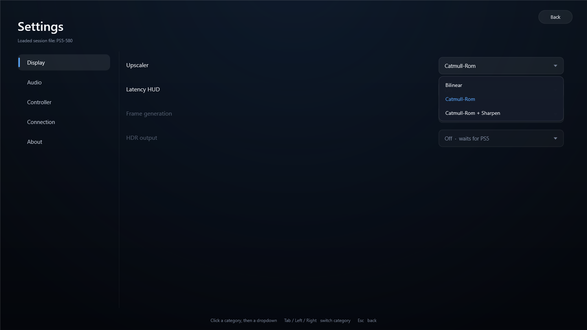
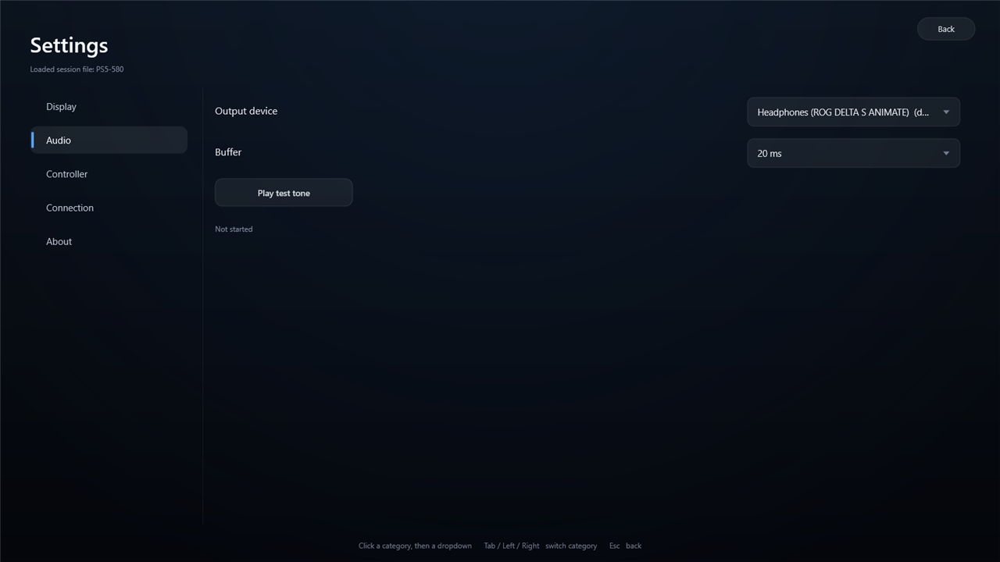
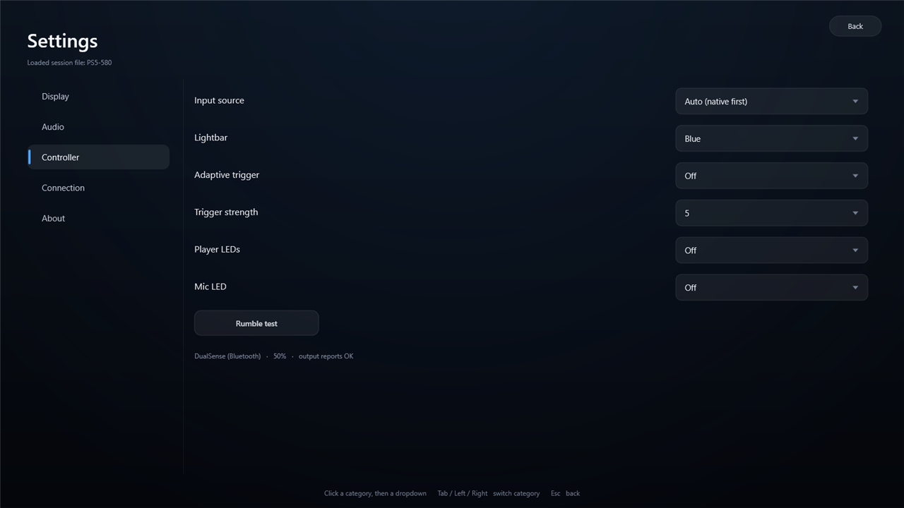
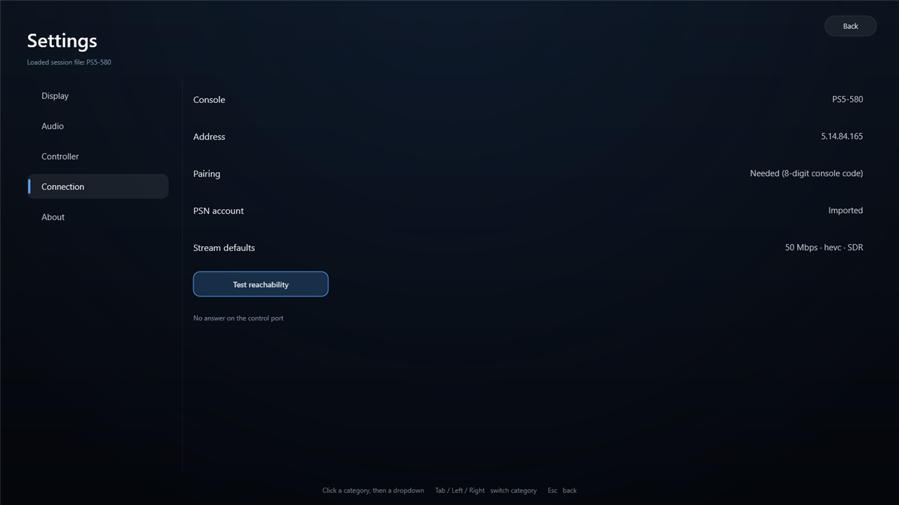

# 08 — The application shell

Status: **v0.5 — live.** Pairing, streaming (video + audio), categorized settings, FSR1/Lanczos upscaling, HDR-capable presenter.

---

## Screens

### Home

- Horizontal game rail, spring-animated selection, dynamic accent glow.
- **Console card** (top right): console name, status, address, and a `Connect` button.
- `Stream` opens the stream screen for the selected game.
- The connected controller is shown under the console status in the main card.


### Settings

Five categories in a left sidebar, each with its own settings — nothing is lumped together:

| Category | Contents |
|---|---|
| Display | Upscaler, upscale target (window/1080p/1440p/2160p), latency HUD, frame generation (NVIDIA VFG 2x), video decoder (Auto/D3D11VA/D3D12VA/Vulkan/DXVA2/CUDA/Software), HDR (startup) |
| Audio | Output device, buffer size, test tone, live format/latency/underruns |
| Controller | Input source, lightbar, adaptive trigger, strength, player LEDs, mic LED, rumble |
| Connection | Console, address, pairing, PSN account browser sign-in (stores the account ID), stream defaults, reachability test |
| About | Version, description, legal note |

Every setting is a **dropdown** (or a button), not a key cycle. Dropdowns open a popup list, close on outside click, and show the current value with ellipsis when it does not fit.









### Boot sequence

There is no console window: the executable is linked as a Windows GUI
subsystem, so it opens straight into the in-app logo intro, followed by the boot
screen before Home. The boot screen shows the BRP mark in a rotating double ring,
the app name, a progress bar, the current stage ("Preparing audio", "Starting
DLSS Frame Generation", ...), step dots and the current display refresh rate.

Session load, LAN discovery, audio enumeration, NVIDIA runtime detection and the
DLSS SR / VFG / NR worker startup all run on background threads. The
presentation thread only animates and presents the boot screen, so the loader
stays at the monitor refresh rate (240 Hz here) even while NGX or the NR worker
starts. `BRP_LOOP_PROBE=1` logs the measured loop rate.

### Startup

The window stays hidden until the first frame is presented, so there is no white
flash. The first frames are a logo build-up on the app palette:

1. `RemotePlay` fades in, centred.
2. `but` appears centred underneath it (accent colour).
3. `Better` completes the second line to the right ("but Better"); both lines
   stay centred as the word grows.

The window is skippable with a click or any key. Total run: ~3.6 s including the
fade-out.

### In-stream idle

While a session is live, 3 s without mouse movement hides the `Disconnect`
button and the OS cursor. Moving the mouse brings it back immediately; the fade
takes 0.35 s. The stats HUD is independent and stays on if enabled. With DLSS Frame Generation the worker's child window sits above the UI:
moving the pointer into the top strip reveals the chrome, and it stays revealed
for 2 s after leaving that strip so the Disconnect button can be reached.

### Window chrome and pacing

- Navigation is icon-led: the Home `Settings` pill is now a gear button (an
  8-tooth ring modeled on the Lucide settings silhouette, not thin sun rays),
  the Settings sidebar has an icon for every category, the stream overlay tabs
  carry icons, the stream chrome has a power button for Disconnect, and the
  Settings screen uses a chevron for Back. The in-stream Back button is gone.
- Typography is a pairing: Noto Sans Display for headings and Noto Sans for
  body/small text, both bundled (SIL OFL). Sony's SST is proprietary, so Noto
  Sans - the open family used in PlayStation's OSS stack - is the closest
  distributable match. The fallback on systems without the font folder is Segoe
  UI Variable Display/Text.
- The OS title bar is gone (`WM_NCCALCSIZE` returns 0). The app draws its own
  bar with the brand and minimize / maximize-restore / close buttons, including
  hover states.
- DWM gives the windowed frame a small rounding (`DWMWCP_ROUNDSMALL`).
  Maximized and F11 borderless fullscreen use `DWMWCP_DONOTROUND`, so the stream
  reaches the display edges.
- The caption drags the window (`HTCAPTION`), the outer 6 DIP is a native resize
  border, and double-clicking the caption toggles maximize. `WS_OVERLAPPEDWINDOW`
  is retained, so snap, minimize, restore and the taskbar keep working.
- The main loop is paced at the monitor's refresh rate (240 Hz on this machine),
  read from `MONITORINFOEX` + `EnumDisplaySettings` and refreshed on display
  changes and monitor moves. Frame generation presents on its own thread, so it
  no longer dictates the UI cadence.
- With DLSS Frame Generation active the worker's child presenter covers the
  client. Moving the pointer into the top strip temporarily hides that child, so
  the title bar, `Disconnect` button and HUD are visible and clickable; it stays
  hidden for 2 s after leaving the strip, then the clean stream returns.

### Display scaling

The UI is drawn in a virtual 1600x900 space and scaled by
`clamp(backbuffer_height / 900, 1.0, 2.5)` through the D2D transform. Mouse
coordinates are divided by the same factor for hit testing. On a 1440p fullscreen
backbuffer the scale is 1.6, so the HUD and settings keep their 900p physical size
instead of becoming tiny. On a 4K display the scale is 2.4 (virtual 1600x900).

### Stream

The measured post-process pipeline running full-window, with a live latency HUD and a controller chip.

---

## Controls

| Where | Action |
|---|---|
| Mouse | Hover highlights, click selects/activates, wheel moves the rail |
| Home | `Left`/`Right` select · `Enter` stream · `S` settings · `Esc` quit |
| Settings | `Tab` / `Left` / `Right` switch category · `Esc` closes a dropdown, then leaves |
| Stream | `Esc` back - `H` HUD - `1`..`5` upscaler - `Tab` settings overlay |
| Stream settings overlay | Mouse dropdowns apply live; `Tab`/`Esc` resume; decoder applies next session |
| Any | `F12` capture the current frame to `app-<screen>.bmp` |

Controller navigation still works on Home (d-pad/stick, Cross, Circle, Options).

---

## Code map

```
src/main_app.cpp              message loop, monitor-refresh pacing
src/app/app.{h,cpp}           screens, hit regions, dropdowns, layout, animation
src/ui/ui_renderer.*          Direct2D + DirectWrite (rects, rounded clips,
                              gradients, text cache, ellipsis trimming)
src/ui/theme.h                palette
src/media/pipeline.*          D3D11 device, flip-model swapchain, stream surface
src/audio/audio_engine.*      WASAPI render engine (in-process, no driver)
src/net/reachability.*        TCP probe for the console control port
src/session/profile.*         session file, PXPlay metadata import
src/platform/gamepad.*        HID (DualSense/DS4) + XInput
src/platform/win32_window.*   window, mouse/keyboard, per-monitor DPI
```

---

## Design rules

1. **No browser in the video path.** Direct2D onto the same swapchain; only the HUD composites over the stream.
2. **One device.** Decoder, post-process, presenter and UI share one `ID3D11Device`.
3. **Hit regions are built while drawing**, then tested in reverse draw order, so a click can never miss what is visible. Dropdown items are registered last, which is why a popup always wins over the control beneath it.
4. **No fake controls.** Rows that are not implemented are disabled and labelled (for example `Off · needs RIFE model`), and `Connect` performs a real reachability probe rather than pretending to pair.

---

## What is demo data

| Thing | Now | When wired |
|---|---|---|
| Game library | 8 invented titles with procedural art | PSN library via OAuth |
| Console card | Real metadata imported from PXPlay | Live discovery + session state |
| `Connect` | TCP probe of port 9295 | Pairing + session handshake |
| Stream source | Synthetic 1080p generator | HEVC decode output |
| Bitrate / codec / HDR | Stored in the session profile, shown read-only | Negotiated with the console |

---

## Next

1. Wire the chiaki-ng core into `brp-session` and turn `Connect` into a real pairing flow.
2. Feed decoded Opus into the audio engine and decoded video into the presenter.
3. Replace the rail's demo library with the user's PSN library.

---

## In-stream UI behaviour (18 Nov 2026)

- **Esc needs a second press.** On Home the first Esc shows "Press Esc again to
  quit." and the second quits. In the stream the first Esc shows a centred
  "Press Esc again to disconnect" pill and only the second one disconnects. The
  two-second window resets after any action.
- **Connecting screen** uses the same visual language as the boot animation
  (gradient, orbiting spinner, status line, breathing bar). It is opaque and
  also covers the gap until the first decoded frame, so the presenter's
  synthetic test pattern is never visible.
- **The in-stream settings sheet is 1020 logical px wide and centred** (was
  window-wide). The shared widgets read a content frame (`panel_x_`,
  `panel_right_`) so labels, controls and hit boxes stay aligned inside it;
  the full Settings page keeps the old margins.
- **Disconnect** sends an idle pad state and an RST (see
  `docs/09-session.md`), so the console frees the pairing immediately.

---

## Settings tab map (18 Nov 2026)

| Tab | What lives here |
| --- | --- |
| Display | HDR output, video decoder, chroma upsampling, Latency HUD |
| Upscaling | Upscaler, DLSS model, DLSS mode, upscale target, DLSS Frame Generation, NVIDIA VFG (legacy) |
| Color | Colour controls, sharpening, presets, status line |
| Performance | Frame buffer, NVIDIA Reflex, launch presets |
| Neural | DLSS Neural Rendering (NR): pipeline, scale, passes, style, strength, character |
| Audio | Output device, buffer, test tone |
| Controller | Input source, report rate, rumble, triggers, motion, lightbar, LEDs |
| Connection | Bitrate, stream resolution, stream FPS, reachability test |
| Debug | Sections of the latency HUD (the master switch is under Display) |
| About | Version and notes |

## Visual pass (18 Nov 2026)

- **Home**: the hero card has a top accent line, a console silhouette with its
  glow on the right, and text that stops before it.
- **Settings**: every tab's content sits on one glass card (`kPanel` at 46 %), so
  groups read as sections.
- **Controls**: dropdowns take an accent stroke on hover; sliders have a thinner
  track and a halo on the knob; primary buttons are brighter with a warm edge.
- **Not done**: a game rail with cover art. The library list is still demo data
  (invented titles), so it stays out until the PSN library is wired.

- **In-stream sheet** uses the same tab names and grouping as Settings: Display
  (decoder, chroma, Latency HUD), Upscaling (upscaler, target, DLSS, DLSS and
  VFG frame generation), Colour, Neural, Audio, Controller and Performance
  (frame buffer, Reflex). The sheet panel uses the same glass fill and accent
  edge as the Settings card. Tab width is 124 px so "Performance" fits.

## Loaders (18 Nov 2026)

- **Boot**: the mark draws itself in over the first second (glow, rings, tile),
  then the title. A step card lists the real start-up tasks: looking for
  consoles, then each `boot_tasks_` label, with done / active / pending states
  driven by the boot worker. The progress bar and percentage are under the card.
- **Connect**: the same loader, shown from the moment Connect is pressed (probe
  included). The four steps follow the real state: checking the console, waking
  it, opening the session, waiting for the first frame.
- Shared helpers: `DrawLoaderMark` (rings and tile, with a reveal factor) and
  `DrawLoaderSteps` (the step list).
