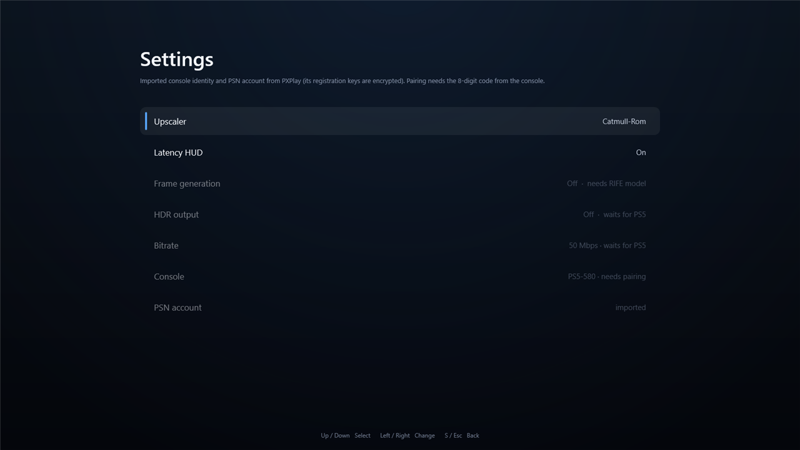

# 09 — Session data: what can be imported, and from where

Short answer: **PXPlay's registration keys cannot be copied.** They are encrypted with a key that never leaves the app, and there is no export function. What *is* plaintext is enough to remove the annoying half of pairing, and that is now imported automatically.

---

## What "session info" actually is

The Remote Play registration handshake produces a small set of values per console:

| Value | Size | Sensitivity | Produced by |
|---|---|---|---|
| `target` / console id | 6–12 bytes | public | discovery, console |
| `server_mac` | 6 bytes | public | discovery |
| `server_nickname` | string | public | console |
| `rp_key` | 16 bytes | **secret** | registration |
| `rp_regist_key` | 16 bytes | **secret** | registration |
| `rp_key_type` | u32 | public | registration |
| `console_pin` | u32 | low | console UI |
| PSN account id | 8 bytes (base64 for the protocol) | account identifier | PSN login |

Chiaki's own structs confirm the sizes: `ChiakiRegisteredHost` holds `rp_regist_key[0x10]`, `rp_key[0x10]`, `rp_key_type`, `console_pin`, `server_mac`, `server_nickname`.

Only the two 16-byte keys are actually secret. Everything else is metadata.

---

## What PXPlay stores, and where

Verified on this machine (`PXPlay 3.1.1`):

| Path | Content | Readable? |
|---|---|---|
| `%APPDATA%\PXPlay\integration\consoles.json` | console id, display name, device type | **yes, plaintext** |
| `%APPDATA%\PXPlay\Data\prefs.json` | PSN numeric account id, cached address, video prefs | **yes, plaintext** |
| `%APPDATA%\PXPlay\Data\secure.json` | `ps_remote_profiles`, `psn_remote_tokens`, `ACCESS_DETAILS`, `checksum_value`, `context_value`, `timestamp_value` | **no — ciphertext** |
| `%LOCALAPPDATA%\PXPlay\trusted-roots.p12` | TLS roots | not useful to us |
| `%APPDATA%\PXPlay\psplay_license_v2` | licence blob (starts with `streamin…`) | not useful to us |

Measured shape of `secure.json`:

| Field | Encoded | Decoded |
|---|---|---|
| `ps_remote_profiles` | 320 b64 chars | 240 bytes, high entropy, not JSON, not gzip/zlib |
| `psn_remote_tokens` | 536 b64 chars | 400 bytes, high entropy |
| `ACCESS_DETAILS` | 172 b64 chars | 128 bytes, high entropy |
| `checksum_value` | 64 b64 chars | 48 bytes (integrity tag) |
| `context_value`, `timestamp_value` | 32 b64 chars each | 24 bytes each |

A scan of the installed binaries for `exportProfile`, `importProfile`, `backupProfile`, and friends found nothing. There is no supported way to get the keys out, and the decryption key is derived from machine-bound state inside a closed-source app. Reverse-engineering that is out of scope and not something this project will ship.

**Conclusion:** PXPlay → BetterRemotePlay is **metadata-only.**

---

## What we import (implemented)

`session::ImportPXPlay` reads only the two plaintext files and produces a `Profile`:

| Field | Source |
|---|---|
| `name` | `consoles.json` → `displayName` (`PS5-580`) |
| `device_type` | `consoles.json` → `deviceType` (`PS5`) |
| `target_id` | `consoles.json` → `consoleId` |
| `psn_numeric_id` | `prefs.json` → `SELECTED_PSN_PROFILE_ACCOUNT_ID` |
| `psn_account_id` | derived: base64 of the 8-byte big-endian account id |
| `host` | `prefs.json` → `cached_direct_ip_addresses` (last used address) |
| `rp_key`, `rp_regist_key` | **empty** — pairing will fill them |

Result, on this machine:

```
name          PS5-580
device_type   PS5
target_id     2840ddf38ed9
host          5.14.84.165        (last cached address)
psn_account_id <12 chars base64> (derived from the decimal account id)
rp_key        (empty)
rp_regist_key (empty)
```

The app writes this to `%APPDATA%\BetterRemotePlay\session.json` and shows:

- Home top bar: `PS5-580 · needs pairing` (amber)
- Settings → Console: `PS5-580 · needs pairing`
- Settings → PSN account: `imported`
- Settings subtitle: explains that the keys are encrypted and that pairing needs the console's 8-digit code



---

## Why the account id conversion matters

PXPlay stores the PSN account id as a decimal number. The registration handshake wants **base64 of its 8-byte big-endian form**. That conversion is the step users usually fail at, and it is why chiaki tells people to paste a base64 string from a helper website. We derive it locally, from data the user's own PXPlay already has.

`session::AccountIdBase64(7022189752615828203)` → 12-character base64 string, standard padding.

---

## Our session file

`%APPDATA%\BetterRemotePlay\session.json`:

```json
{
  "name": "PS5-580",
  "device_type": "PS5",
  "target_id": "2840ddf38ed9",
  "host": "192.168.1.42",
  "psn_numeric_id": "…",
  "psn_account_id": "…",
  "rp_key": "<32 hex chars>",
  "rp_regist_key": "<32 hex chars>",
  "rp_key_type": 0,
  "console_pin": 0,
  "width": 1920,
  "height": 1080,
  "fps": 60,
  "bitrate_kbps": 50000,
  "codec": "hevc",
  "hdr": false
}
```

Load order at startup:

1. `session.json` if it exists (our own state wins),
2. otherwise import PXPlay metadata and save.

Notes:

- Keys are stored as hex because it is diff-friendly and matches chiaki's `rp_key`/`rp_regist_key` bytes exactly.
- The file will contain secrets once pairing lands. It lives under `%APPDATA%`, not in the repo. **Phase 6 hardens this with DPAPI**, and the `.gitignore` already excludes `*.key`, `*.token`, `secrets/`.
- `host` is whatever was cached (often a WAN address). LAN discovery will find the local address anyway; a manual IP can always be set.

---

## Next import target: chiaki / chiaki-ng

chiaki stores the same values in **plaintext** via `QSettings` (`target`, `rp_key`, `rp_regist_key`, `rp_key_type`, `console_pin`, `server_mac`, `server_nickname`), where the keys are 16-byte `QByteArray`s. If someone has paired with chiaki-ng, their keys are genuinely portable to us.

The loader already accepts hex `rp_key`/`rp_regist_key`, so this is a converter, not a new format. Not implemented yet because chiaki is not installed on this machine — but it is the one path where "copy the session info" is fully achievable.

---

## The supported path, in one line

Pair once with the console's 8-digit code. It takes ~30 seconds, produces **our own** keys, and from then on import is irrelevant. The metadata import above exists purely so that the account-id scavenger hunt disappears.

---

## Disconnect and reconnect

`DisconnectStream` (Esc in the stream, or the Disconnect button) now:

1. Sends one **idle controller state** to the console (no buttons, no trigger
   pull) and waits ~24 ms so the feedback thread delivers it before the sockets
   close. Without this, disconnecting while holding a trigger could leave the
   console acting on a stuck input.
2. Calls `chiaki_session_stop`, which closes the control and stream sockets
   cleanly, then joins the session thread.

The console still reserves the session for a short moment. If a Connect lands
inside that window, the console answers "Remote Play on Console is already in
use"; instead of showing that error once, the app retries every 2.5 s (up to 12
times) with the note "Console is still releasing the previous session (retry
N/12)...". Measured on the reference machine: a reconnect 0.4 s after
disconnect succeeds on the first attempt.
