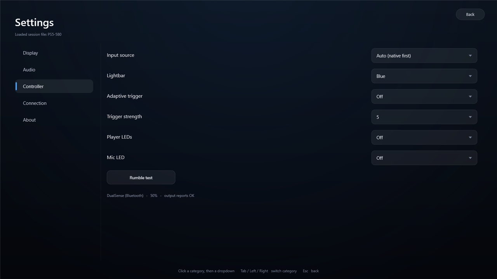

# 10 — Input: mouse, keyboard, controller, DualSense

Status: **mouse and controller navigation work; DualSense input and output work over Bluetooth.**

---

## Mouse

| Action | Result |
|---|---|
| Hover a tile | Tile border brightens, hand cursor |
| Click a far tile | Selects it (rail slides) |
| Click the selected tile | Opens the stream |
| Click a settings row | Selects it |
| Click the left/right zone of a row | Changes the value |
| Click `Settings` pill / `Back` | Navigates |
| Wheel | Moves the selection |

Hit regions are rebuilt every frame while drawing, then tested in reverse draw order, so the topmost element always wins. No separate layout pass, so a region can never drift from what is on screen.

---

## Keyboard

| Screen | Keys |
|---|---|
| Home | `Left`/`Right` or `A`/`D` select · `Enter` stream · `S`/`Tab` settings · `C` controller · `Esc` quit |
| Settings | `Up`/`Down` select · `Left`/`Right` change · `Enter` open · `S`/`Esc` back |
| Settings → Controller | Dropdowns and buttons; `Tab` switches category |
| Stream | `Esc` back · `H` HUD · `1`/`2`/`3` upscaler |
| Any | `F12` capture frame |

---

## Controller

Two backends, one state:

```
DualSense / DS4  ──raw HID──┐
                            ├──► PadState ──► UI navigation
Xbox / virtual   ──XInput───┘             └──► (future) PS5 report forwarding
```

HID takes priority. Sony pads are found by VID/PID (`054C:0CE6`, `054C:05C4`, `054C:09CC`) through SetupAPI, with automatic reconnect every 2 s.

### Navigation mapping

| Input | Action |
|---|---|
| D-pad, left stick | Move (350 ms initial repeat, 110 ms after) |
| Cross | Confirm |
| Circle | Back |
| Options | Settings / back |
| L1 / R1 | Previous / next tile on Home |

### Supported reports

| Connection | Input report | Output report |
|---|---|---|
| USB | `0x01`, 64 bytes | `0x02`, 48 bytes |
| Bluetooth | `0x31`, 78 bytes (`0x01` 10-byte simple mode also parsed) | `0x31`, 78-byte report, zero-padded to `OutputReportByteLength` (547 on Windows) |

### Bluetooth checksum (fixed 18 Nov 2026)

Sony signs the first 74 bytes of the Bluetooth `0x31` output report with a
CRC32 seeded by processing the byte `0xA2` through the raw table after an
`0xFFFFFFFF` init, then inverting the result:

```
crc = crc32_le(0xFFFFFFFF, &seed, 1);
crc = ~crc32_le(crc, data, 74);
```

The old code used the zlib convention (`init = ~seed`), which produces a
different value for every packet. The controller validated the checksum,
rejected every Bluetooth output report, and silently ignored rumble, LEDs and
trigger effects; USB has no checksum, which is why cable worked. Verified
against `drivers/hid/hid-playstation.c` and by the Rumble test over Bluetooth.

Detection is by `HIDP_CAPS.InputReportByteLength`: 64 = USB, 78 = Bluetooth extended, ≤11 = Bluetooth simple.

---

## DualSense feature matrix

| Feature | State | Notes |
|---|---|---|
| Buttons, sticks, triggers | ✅ | USB + Bluetooth, forwarded live |
| D-pad as hat | ✅ | decoded from the 4-bit hat |
| Touchpad touch points | ✅ forwarded | 2 points, native 1920×1080 coordinates |
| Touchpad click | ✅ | `PadTouchpad` → protocol button |
| Gyro / accelerometer | ✅ forwarded | scaled to rad/s + g, Madgwick quaternion |
| Battery % + charging | ✅ | from the status byte |
| Mute button | ✅ | |
| Lightbar RGB | ✅ output | bytes 45–47 of the `0x02` report (fixed in this pass) |
| Player LEDs | ✅ output | byte 43/44, or console-driven |
| Mic LED | ✅ output | off / on / pulse |
| Adaptive triggers | ✅ both ways | 8 manual effects + console effects passed through |
| Rumble (2 actuators) | ✅ both ways | local test + console rumble with intensity scaling |
| CRC32 for Bluetooth | ✅ | polynomial `0xEDB88320`, seed `0xA2` |
| Input/report rate | ✅ | 60 / 125 / 250 / 500 / 1000 Hz, high-resolution timer |
| Trigger effect calibration | ⚪ | firmware-provided ranges not applied |
| Haptic voice-coil stream | ⚪ | needs the audio-haptic path over USB (see below) |
| Speaker / headset audio | ⚪ | separate USB audio interface |
| Gyro calibration | OK | feature report 0x05 parsed, SDL/DS5 math; raw scale fallback |
| Console-driven effects | ✅ | rumble, trigger effects, lightbar, player LEDs, intensities |

### Rumble on newer DualSense firmware (fixed 2026-11-16)

The DualSense on this machine reports firmware `0x0630`. That firmware ignores the
old rumble-emulation path (`ucEnableBits1 bit 0x01` + half-scale values). The output
report now reads firmware feature report `0x20` at open and selects:

| Firmware | Enable bits | Rumble values |
|---|---|---|
| `< 0x0224` (older) | `enable1 |= 0x01` | `weak >> 1`, `strong >> 1` |
| `>= 0x0224` and Edge | `enable3 |= 0x04` | full values |

Verified live before shipping: `hid: DualSense (Bluetooth) ... firmware=0x0630` and
`[hid] rumble weak=200 strong=240 fw=0x0630 edge=0 path=new` during the Rumble test.
The controller physically rumbles with the test; in-game console rumble uses the same
report. `BRP_PAD_PROBE=1` logs each console rumble event, each HID rumble report and
the live calibrated gyro/accel values.

On Windows the Bluetooth interface advertises `OutputReportByteLength = 547`. The
78-byte `0x31` report must be zero-padded to that length (see gotcha 2), so the log
also shows `[hid] output report 78 -> 547 bytes (padded)` once per open. The older
78-byte write failed with `ERROR_INVALID_PARAMETER (87)`, which is why rumble, LED
and trigger effects did nothing over Bluetooth even though the report bytes were
otherwise correct.

### Gyro calibration

Feature report `0x05` is parsed at open (same layout as SDL/DS5): per-axis bias and
sensitivity for gyro and accelerometer. `PadState` now carries calibrated
`gyro_dps`/`accel_g`; the Madgwick orientation tracker consumes those. If the report
is unavailable or out of range, the standard 1024 counts/deg/s and 8192 counts/g
scales are used. The Controller tab shows `gyro calibrated` or `gyro default`, plus
live `Gyro x / y / z dps` and `Accel x / y / z g` values so the motion path can be
checked without starting a stream. `BRP_PAD_PROBE=1` logs the same values once per
second.

### DualSense Edge

Product `0x0DF2` is detected and exposed as "DualSense Edge". The extra HID bits
(function buttons and paddles) are parsed into `PadFnLeft`/`PadFnRight`/`PadPaddle*`.
The Remote Play controller state has no fields for them, so they are not forwarded;
the firmware's normal button mapping is what the console sees.

### Haptic audio (still missing)

Voice-coil haptics are a separate Opus stream and a 4-channel USB audio endpoint. On
Bluetooth there is no audio endpoint at all. Not implemented; requires the controller
on USB and a haptics sink in `Streaming`.

### Adaptive trigger effects implemented

| Effect | Encoding |
|---|---|
| Off | all zero |
| Rigid | `01 00 start force` |
| Pulse | `02 00 start end force` |
| Feedback | `21 zone strength` |
| Weapon | `25 start end strength` |
| Vibration | `26 frequency amplitude FF` |
| Bow | `27 start end force snap` |
| Galloping | `23 start end foot1 foot2 frequency` |

The `0x26` layout is cross-checked against a captured PlayStation Accessories USB report (`26 90 a0 ff …`), which is why the trigger block offsets (11–21, 22–32) are trusted. The 0x2x family comes from community documentation; effects are exposed as a tester, not as a promise of console-identical feel.

---

## Testing it

Settings → Controller (the Controller category).

- Lightbar: 8 presets, applied live.
- Adaptive trigger: 8 effects; strength 1–8; applies to both triggers.
- Rumble: `Enter` fires a 450 ms pulse.
- Player LEDs / Mic LED: cycle masks.
- Live readout: buttons, sticks, triggers, touch point, battery.
- Subtitle reports `output reports OK` / `failed`, i.e. whether the write actually reached the device.



Verified on this machine: DualSense over **Bluetooth**, input 78 bytes. Output reports are built as 78-byte `0x31` + CRC, then padded to the 547-byte HID output length; the Controller tab shows `output OK` and the rumble test reaches the motors. Gyro is live in the same tab (`gyro calibrated`, values in dps/g).

---

## Gotchas that cost time

1. **A HID handle opened with `FILE_FLAG_OVERLAPPED` cannot be written with a null `OVERLAPPED`.** `WriteFile` returns `ERROR_INVALID_PARAMETER` (87). Output needs its own event + `GetOverlappedResult`.
2. **Windows requires the write length to match `HIDP_CAPS.OutputReportByteLength`.** The DualSense Bluetooth interface reports 547 while the actual `0x31` state report is 78. Build the 78-byte report, then zero-pad it to the cap before `WriteFile`; sending 78 bytes directly fails with `ERROR_INVALID_PARAMETER` (87). Verified: `[hid] output report 78 -> 547 bytes (padded)` and `output OK`.
3. **Bluetooth input is 78 bytes, not 10.** The 10-byte `0x01` simple mode is a fallback; the pad on this machine sends `0x31` at 78 bytes. Detecting by "!= 64 means Bluetooth" was wrong - compare against 64 (USB) instead.
4. **XInput never sees a DualSense.** `XINPUT_GAMEPAD_GUIDE` is also not in the public header (value `0x0400`). Sony pads need HID.
5. **Bluetooth output has a 3-byte header.** Byte 0 is `0x31`, byte 1 is the sequence/tag nibble, byte 2 must be `0x10` (magic tag), and the common 47-byte payload starts at byte 3. Copying the USB payload at byte 2 loses `valid_flag0`, so rumble/trigger/LED flags are never set even when the CRC and length are correct.

---

## Next

- Read the calibration feature report `0x05` so gyro becomes calibrated rad/s
  (currently the standard 1024 LSB per deg/s scale is assumed).
- USB audio-haptic path: decode the console's separate haptics Opus stream and
  route it to the DualSense 4-channel USB audio endpoint. Over Bluetooth there
  is no audio endpoint, so this cannot work wirelessly.
- Trigger effect calibration from firmware ranges (currently pass-through).

## PS5 haptics (0.4, 19 Nov 2026)

PS5 games do not use the classic rumble path. They stream **haptics**: stereo
int16 at 3 kHz, on a separate chiaki sink. The app used to subscribe only to
`CHIAKI_EVENT_RUMBLE` (a PS4-era message), so a DualSense stayed silent in PS5
titles.

Now:

- `Streaming` sets `chiaki_session_set_haptics_sink` before the session starts
  and computes the average `|sample| * 2` per channel, like chiaki-ng's
  `PushHapticsFrame`.
- `App` turns that envelope into motor bytes: threshold 100, intensity scale
  (Off / Very weak / Weak / Normal / Strong / Very strong), minimum 512 for the
  9-bit shift, then `>> 8` -- the same arithmetic as chiaki-ng.
- The values go into `PadConsoleFeedback` with `haptics = true`, so the gamepad
  layer does not scale them a second time; the console's own Off nibble still
  applies.
- If no haptics frame arrives for 100 ms the motors are released.
- The HID refresh while rumbling is now 10 ms instead of 20 ms.
- New setting: Settings > Controller > **Haptics intensity** (also in the
  in-stream sheet). Default Normal.

Measured with `BRP_PAD_PROBE`: `[pad] haptics 17 frames/s peak L=1023 R=924`
and `[hid] rumble weak=2..12 strong=2..12` on a DualSense over Bluetooth
(firmware 0x0630). Rumble is felt in game. Full DualSense haptics (audio
endpoint) remains USB-only and is not implemented; Bluetooth uses the motors.
