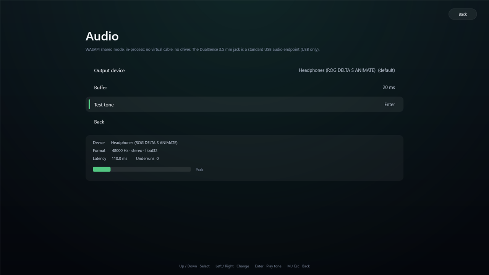

# 11 — Audio

Goal: play the stream's audio on the PC, including into the DualSense's 3.5 mm jack, **without** virtual cables, third-party DLLs, or a driver install.

Status: **engine implemented and verified on hardware** (real endpoint, 48 kHz float, tone + peak meter). The decoder side is the only missing piece.

---

## Why there is no driver and no virtual cable

The usual way people route audio around on Windows is a virtual audio cable (VB-Cable, VoiceMeeter) plus a second app to move it. That is exactly what this project avoids.

Two facts make it unnecessary:

1. **WASAPI is the OS audio API.** An app can open any render endpoint directly and write samples into it. No kernel driver, no filter, no external process.
2. **The DualSense's headphone jack is a standard USB audio device.** Over USB, Windows enumerates `Wireless Controller` as an audio endpoint. Writing to that endpoint *is* routing audio to the controller's 3.5 mm jack. That is the console-like behaviour, achieved by device selection.

The only limitation is physical, not software: **over Bluetooth the DualSense exposes HID only** — no audio endpoint exists, so the jack cannot receive game audio. USB is required for the jack. The app says so on the Audio screen instead of pretending otherwise.

```
Opus → PCM ──► ring buffer ──► WASAPI shared ──► endpoint
                (in-process)                     ├─ PC headphones / speakers
                                                 └─ DualSense jack (USB)
```

---

## Implementation

`src/audio/audio_engine.{h,cpp}` — no dependencies beyond `ole32`/`avrt`:

| Part | Choice |
|---|---|
| API | WASAPI shared mode, event-driven |
| Requested format | 48 kHz · stereo · float32, `AUTOCONVERTPCM` + `SRC_DEFAULT_QUALITY` |
| Fallback | endpoint mix format + in-app linear resample and 16/32-bit packing |
| Buffering | in-process ring, 32 768 frames (~0.68 s), SPSC with atomics |
| Threading | dedicated render thread, MMCSS "Pro Audio" |
| Latency | `buffer_ms` (10/20/30/40) + queued frames |
| Underruns | counted only while audio is flowing (idle silence is not a dropout) |

Producer contract is deliberately tiny:

```cpp
audio_.Push(interleaved_stereo_float_48k, frames);
```

That is the exact shape an Opus decoder produces, so wiring the session later is one call per decoded packet. No resampling in the session layer.

### Device selection

`Engine::Enumerate()` lists active render endpoints, marks the default and flags controller-named devices (`DualSense`, `Wireless Controller`, `DualShock`) so the UI can put them at the top.

The Audio screen lets you cycle endpoints and buffer size, and shows:

- device name and negotiated format
- current latency and underrun count
- a live peak meter
- a 440 Hz test tone with fades, so the path can be verified without a console



Verified on this machine: default endpoint `Headphones (ROG DELTA S ANIMATE)`, `48000 Hz · stereo · float32`, meter moves during the test tone.

---

## Where audio sits in the latency budget

Audio is not just output here — it is the **master clock** for A/V sync. The plan:

1. Opus decode → 20 ms / 10 ms packets at 48 kHz.
2. Push to the ring; the render thread pulls in device-sized chunks.
3. Video presents as close to the audio cursor as pacing allows; drift is corrected by dropping or holding video frames, never by resampling audio.
4. HUD reports audio queue depth separately from video decode/present time.

This is why the engine exposes `played_frames()` and `latency_ms()`: both become the reference for the sync loop.

---

## What is deliberately not here

| Thing | Why |
|---|---|
| Virtual audio cable | Not needed; WASAPI reaches every endpoint directly |
| ASIO | Requires third-party driver; shared WASAPI is within a few ms at 10 ms buffers |
| Exclusive mode | Possible later as an option; fragile when another app owns the device, so not the default |
| Kernel streaming / custom driver | Only buys sub-5 ms; not worth a driver install for this product |
| DualSense haptic audio stream | Separate USB audio-haptic path, future work (see [10-input.md](10-input.md)) |

---

## Next

- Feed decoded Opus frames into `Push()` (needs the session layer).
- Make audio the A/V clock and report drift in the HUD.
- Listen for `IMMNotificationClient` device changes so unplugging headphones doesn't require reopening the screen.
- Optional exclusive-mode toggle for users who want the last few ms.
