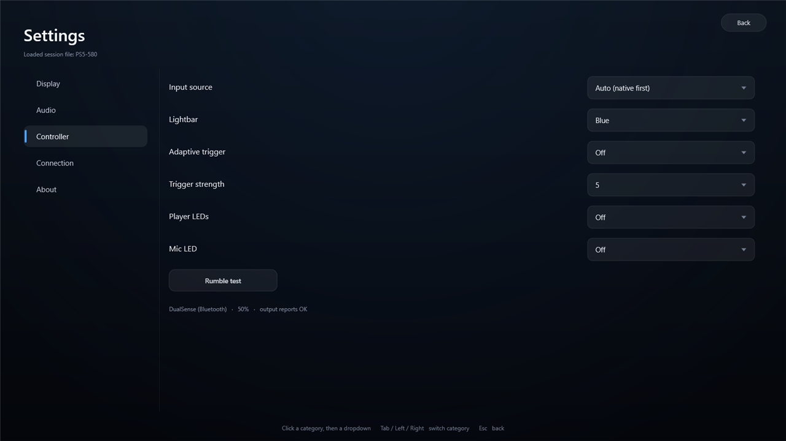

# 12 — Steam Input

Short answer: **yes, and the useful half already works.** Everything depends on which of two different things you mean.

---

## The two meanings

| | Steam Input as **Xbox emulation** | Steam Input **API** (Steamworks) |
|---|---|---|
| What it is | Steam reads the controller and presents a virtual XInput pad to the system | The app talks to Steam's input service through `ISteamInput` |
| What the app needs | nothing | Steamworks SDK, `steam_api64.dll`, a real AppID, an action manifest, launched by Steam |
| Data the app gets | XInput: 14 buttons, 2 sticks, 2 triggers | action sets, digital/analog actions, gyro, touchpad, per-controller info |
| DualSense extras | lost (Steam flattens to XInput) | gyro/touchpad through Steam's config; **still no adaptive-trigger output** |
| Works with Steam closed | yes (it's just a pad) | no |
| Coupling to external software | none | hard dependency on Steam client + redistributable DLL |

The important one for this project is the first: **if Steam Input is set to Xbox emulation, our existing XInput backend already reads it.** No SDK, no DLL, no launch requirement.

---

## What is implemented

Settings → Controller now has an **Input source** dropdown:

| Value | Behaviour |
|---|---|
| `Auto (native first)` | opens the Sony HID device if present, otherwise falls back to XInput. Default. |
| `Native HID only` | Sony HID only. Full DualSense fidelity, ignores XInput. |
| `Steam Input / XInput` | XInput only. This is the mode that consumes Steam's virtual pad. |

Choosing `Steam Input / XInput` closes the HID handle, so it does not fight Steam for the device. Choosing `Auto` reopens HID within 2 s.

The screenshot is with **Steam Input / XInput** selected and no virtual pad present, which is why it reports `No controller detected`. With Steam running and Xbox emulation enabled, the same selection shows `XInput pad (Steam-compatible)`.

### Setting it up

1. Steam → Settings → Controller → enable **Steam Input** for the DualSense.
2. In the per-controller layout, choose **Xbox controller emulation** (not "native").
3. Our app → Settings → Controller → Input source → `Steam Input / XInput`.

Steam then applies your layout, gyro, touchpad and deadzones, and we see the result as a normal XInput pad.

### The honest cost

XInput cannot carry DualSense-specific features. In this mode you lose:

- lightbar / player LEDs / mic LED
- adaptive triggers (our output stage has nothing to bind to)
- touchpad as a distinct surface, gyro as raw data
- battery level

You gain Steam's per-game layouts, and it works with any controller Steam supports. That is a real trade, not a bug — so the default stays native HID, and the choice is explicit.

---

## The Steamworks API path (not implemented)

Full `ISteamInput` integration is the only way to get Steam's *action sets* into the app. Requirements, all mandatory:

1. **`steam_api64.dll` next to the exe** — redistributable, but it must be bundled, i.e. a hard external dependency the app carries.
2. **A valid AppID.** `480` (Spacewar) is for development only; shipping with it is not permitted. A real AppID requires a Steamworks partner account.
3. **An action manifest** (`steam_input_manifest.vdf`) describing action sets and actions, shipped with the app and registered per AppID.
4. **The app must be launched by Steam** with `SteamAppId` set (or a `steam_appid.txt` during development), and the Steam client must be running.

If any of those is missing, `SteamAPI_Init` fails and there is no input at all — the app would have *less* controller support than it has today. That is why this is not the default, and why it cannot be silently enabled.

It also does not solve output: Steam Input has rumble (`TriggerVibration`) but **no adaptive-trigger API**. Trigger effects would still go through our HID output path, and HID + Steam cannot both own the device — so it would have to be either/or, never both.

---

## Recommendation

| Use case | Choice |
|---|---|
| Just playing, want Steam layouts/gyro/deadzones | Steam Input → Xbox emulation + `Steam Input / XInput` |
| Want lightbar, adaptive triggers, touchpad, battery | `Auto` / `Native HID only`, Steam Input off for this pad |
| Want both in the future | two devices, or a Steamworks build with an AppID and accept losing trigger output |

If you want the Steamworks path anyway, it is a well-defined piece of work: bundle the DLL, add a manifest, add a provider behind the existing `Backend` enum, and gate it behind "Steam is running and the API initialized". Say the word and I will scope it — but it will always be optional, never required.

---

## Implementation notes

- The provider split is already there: `Gamepad::Backend { Auto, SonyHid, XInput }`. Adding a `SteamApi` backend means one more branch in `Poll()`, not a rewrite.
- We do not attempt to detect "is this XInput device Steam's virtual pad". It is not reliably observable, so the UI says `XInput pad (Steam-compatible)` and the user chooses the source explicitly.
- `XInputGetState` is polled per frame; Steam's virtual pad has the same latency profile as any XInput device, ~1 frame.
